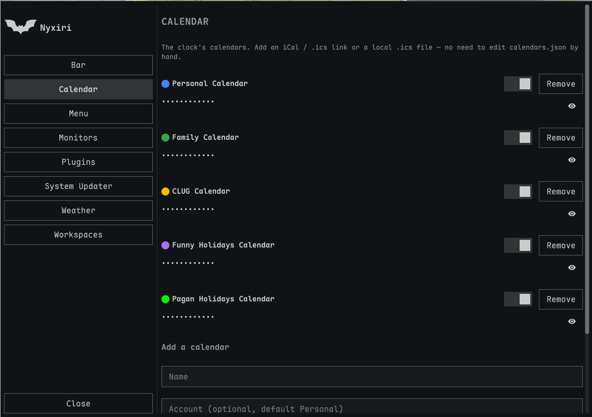
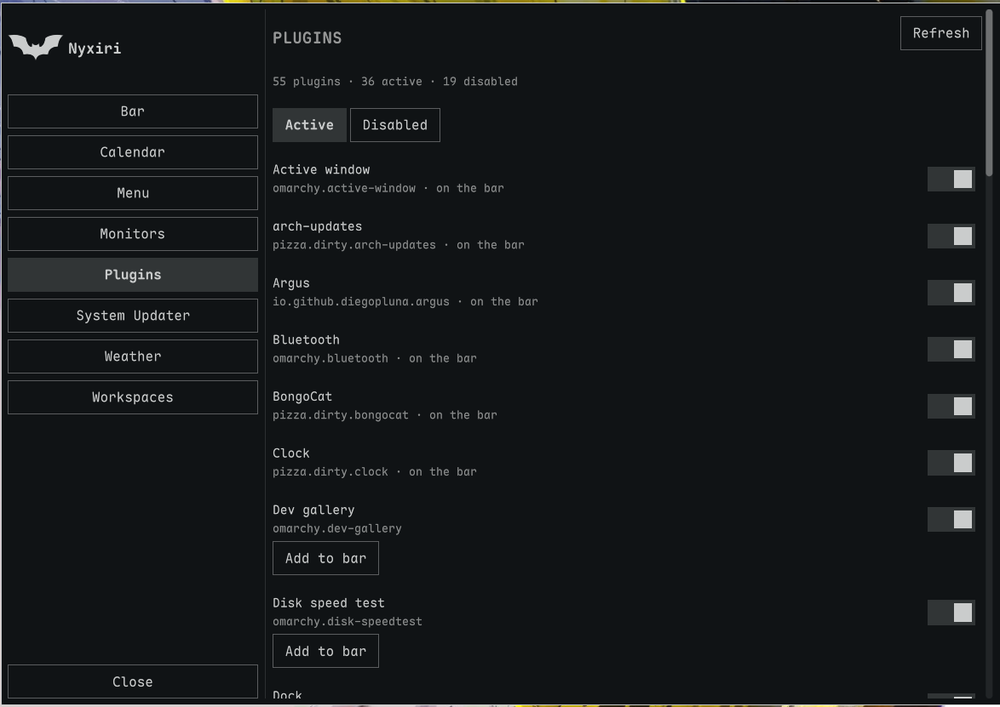
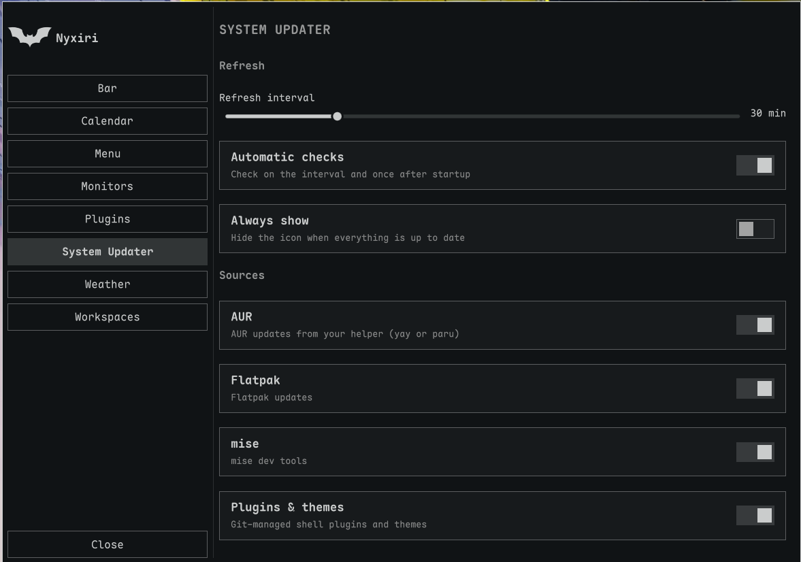
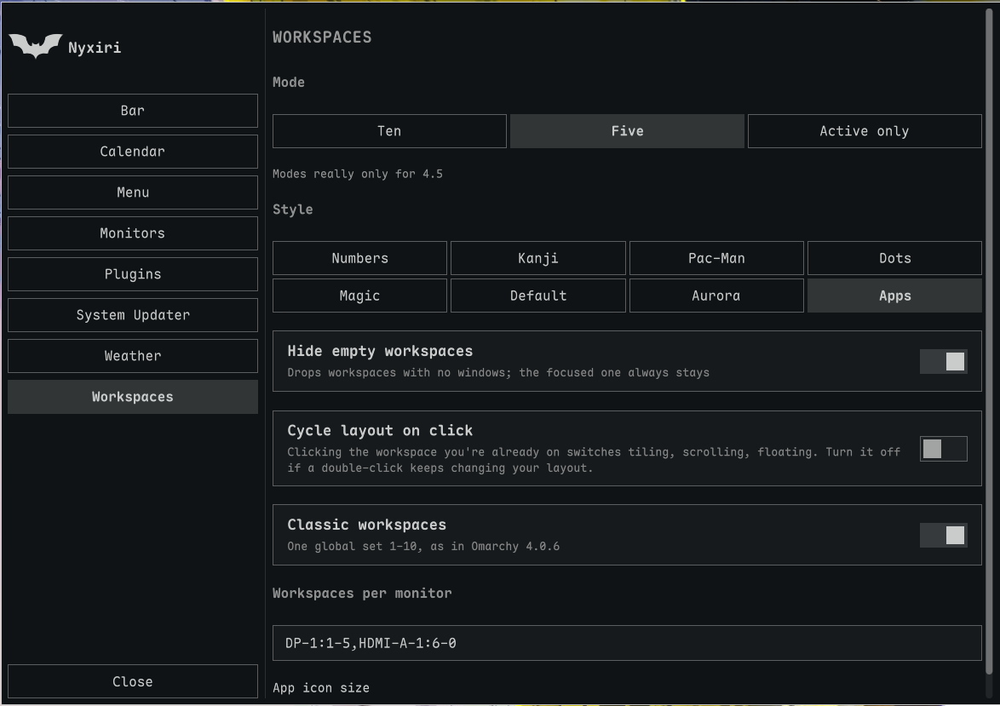

# Nyxiri

Nyxiri is the bar for the Omarchy shell. It styles the bar with rounded pills, per-monitor rules, and theme colors.

## Preview

<table>
  <tr>
    <td></td>
    <td></td>
    <td></td>
    <td></td>
  </tr>
  <tr>
    <td></td>
    <td></td>
    <td></td>
    <td></td>
  </tr>
</table>


## Install

One command installs the bar plus the menu, workspaces, clock, weather, and updates widgets:

```sh
bash <(curl -fsSL https://raw.githubusercontent.com/Deoxizn/nyxiri/main/scripts/install-all.sh)
```

Fish users, wrap it:

```sh
bash -c 'bash <(curl -fsSL https://raw.githubusercontent.com/Deoxizn/nyxiri/main/scripts/install-all.sh)'
```

Add `--with-cats` at the end to also install the cat widgets (cpurr and bongocat).

Bar only:

```sh
omarchy plugin add https://github.com/Deoxizn/nyxiri.git --enable
omarchy bar use pizza.dirty.nyxiri
```

## Use

Open settings by clicking the bat icon at the far right of the bar, or run:

```sh
omarchy-shell pizza.dirty.nyxiri openSettings
```

Settings are saved in `~/.config/omarchy/shell.json` under `bar.nyxiri`.

The settings window has eight tabs. A tab only shows when its plugin is installed.

- **Bar** — pill shape, colors, and bar background.
- **Calendar** — add calendar links or local .ics files.
- **Menu** — menu trigger icon and wordmark.
- **Monitor Bars** — turn a monitor's bar on or off, pick its widgets, pick which bar shows the bat.
- **Plugins** — turn plugins on or off, add one to the bar, switch bars.
- **System Updater** — update checks and per-source toggles.
- **Weather** — second city.
- **Workspaces** — workspace style, hide empty, Classic mode.

To go back to the stock bar:

```sh
omarchy bar reset
omarchy plugin disable pizza.dirty.nyxiri
```

## Licence

MIT.
