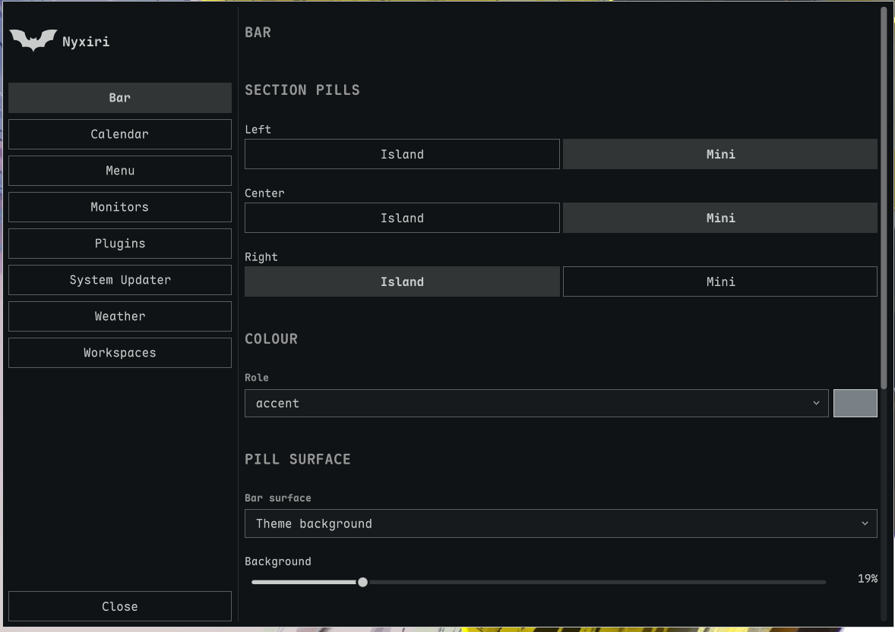
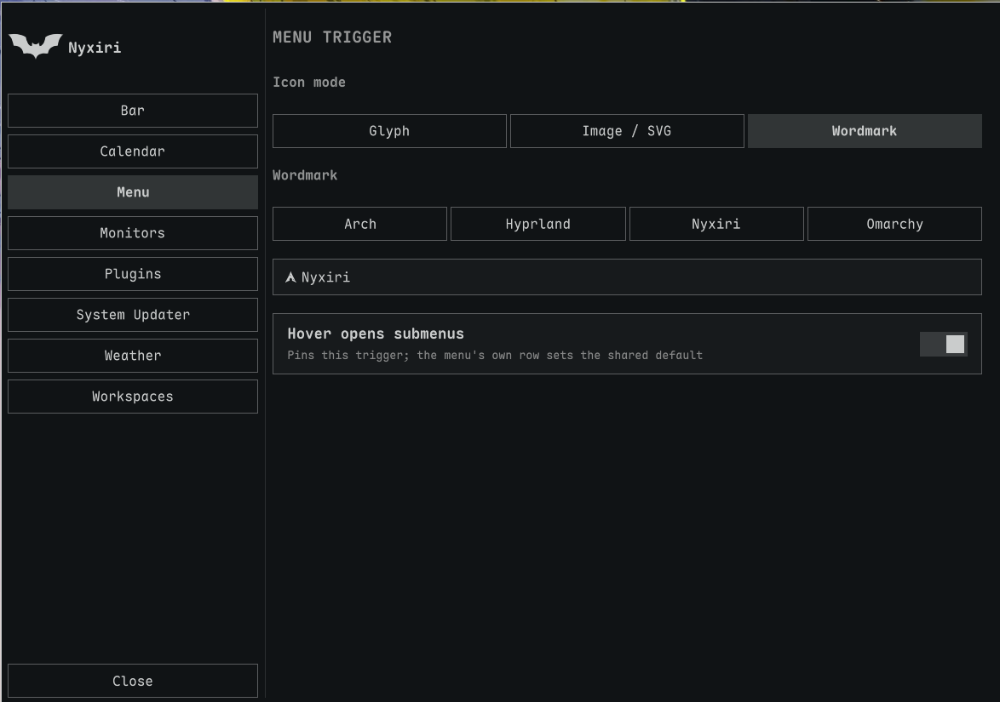
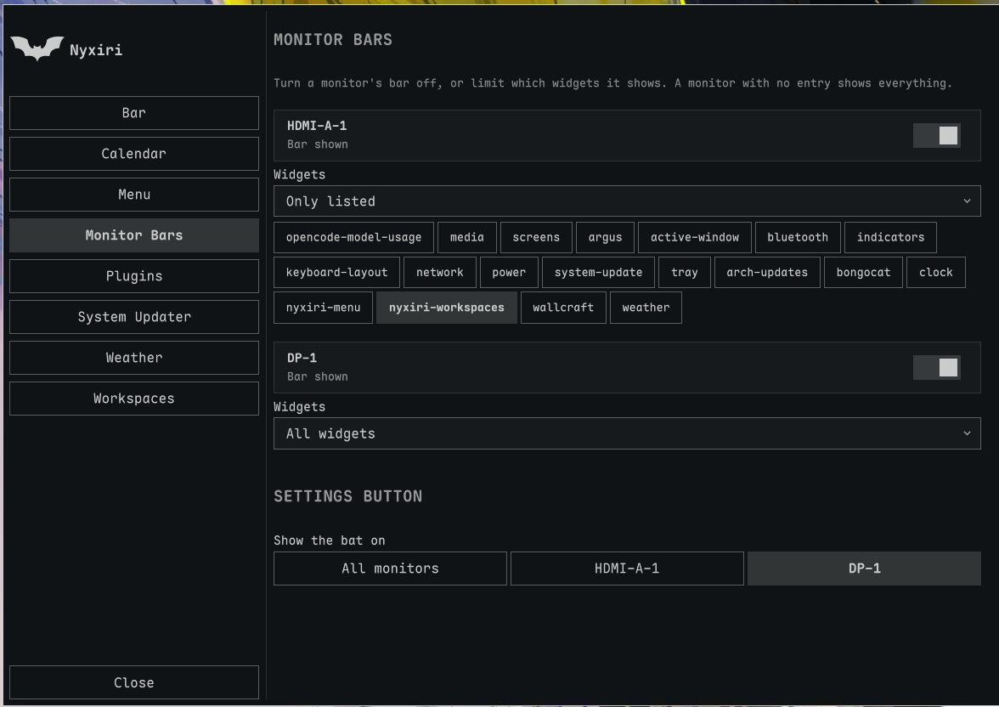
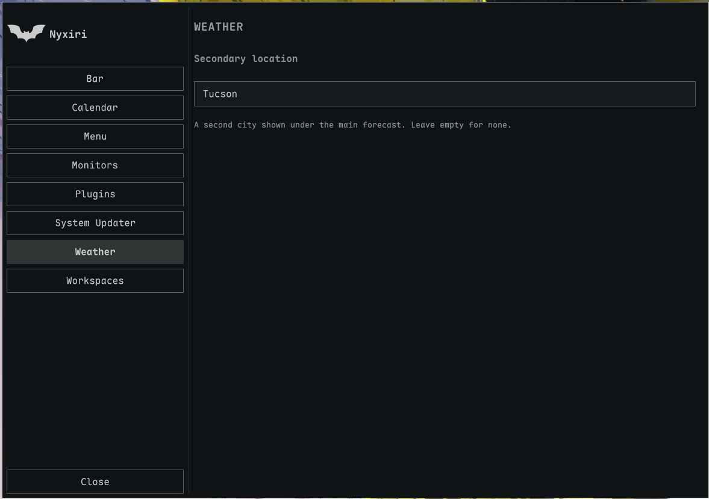
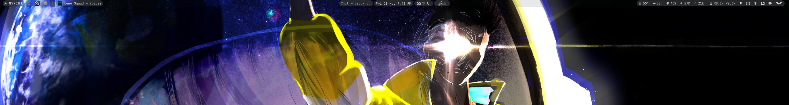

# Nyxiri

Nyxiri is the bar for the Hexciri shell. It styles the bar with rounded pills, per-monitor rules, and theme colors.

Requires Hexciri 2.0. This is the `nyx` branch; the Omarchy version lives on `main`.

## Preview

<table>
  <tr>
    <td></td>
    <td></td>
    <td></td>
    <td></td>
  </tr>
  <tr>
    <td></td>
    <td></td>
    <td></td>
    <td></td>
  </tr>
</table>



## Install

One command installs the whole suite on Hexciri 2.0:

- Bar: [**nyxiri**](https://github.com/Deoxizn/nyxiri) (`pizza.dirty.nyxiri`)
- Menu: [**nyxiri-menu**](https://github.com/Deoxizn/nyxiri-menu) (`pizza.dirty.nyxiri-menu`)
- Workspaces: [**nyxiri-workspaces**](https://github.com/Deoxizn/nyxiri-workspaces) (`pizza.dirty.nyxiri-workspaces`)
- Clock: [**clock**](https://github.com/Deoxizn/omarchy-clock) (`pizza.dirty.clock`)
- Weather: [**weather**](https://github.com/Deoxizn/omarchy-weather) (`pizza.dirty.weather`)
- System Updater: [**arch-updates**](https://github.com/Deoxizn/Arch-Updates) (`pizza.dirty.arch-updates`)

Preferred, on a machine that already has Hexciri 2.0 installed (this also
re-adds any Nyxiri plugins already installed from another branch, from
`nyx`, settings preserved):

```sh
bash ~/.local/opt/hexciri-nyx/v2/install.sh --yes --no-reboot --with-nyxiri
```

Add `--with-cats` to also install the cat widgets: [**cpurr**](https://github.com/Deoxizn/omarchy-cpurr) (`pizza.dirty.cpurr`) and [**bongocat**](https://github.com/Deoxizn/omarchy-bongocat) (`pizza.dirty.bongocat`).

`hexciri update` does not forward `--with-nyxiri`, so a fresh Nyxiri
install needs the installer command above, not just an update.

Or install the suite standalone, without the Hexciri installer:

```sh
bash <(curl -fsSL https://raw.githubusercontent.com/Deoxizn/nyxiri/nyx/scripts/install-all.sh)
```

Fish users, wrap it:

```sh
bash -c 'bash <(curl -fsSL https://raw.githubusercontent.com/Deoxizn/nyxiri/nyx/scripts/install-all.sh)'
```

Add `--with-cats` at the end of either command to also install the cats.

Wallcraft (`pizza.dirty.wallcraft`) is not included in this installer; it is a separate, independent install:

```sh
git clone --branch nyx https://github.com/Deoxizn/wallcraft.git ~/.config/hexciri/plugins/pizza.dirty.wallcraft
hexciri plugin enable pizza.dirty.wallcraft
```

Bar only, by hand (`hexciri plugin add` has no `--branch` flag, it clones
the default branch, so a `nyx` install is a git clone plus enable):

```sh
git clone --branch nyx https://github.com/Deoxizn/nyxiri.git ~/.config/hexciri/plugins/pizza.dirty.nyxiri
hexciri plugin enable pizza.dirty.nyxiri
hexciri bar use pizza.dirty.nyxiri
```

Update it later (pulls the checked-out `nyx` branch):

```sh
hexciri plugin update pizza.dirty.nyxiri --yes
hexciri restart shell
```

## Use

Open settings by clicking the bat icon at the far right of the bar, or run:

```sh
hexciri-shell pizza.dirty.nyxiri openSettings
```

Settings are saved in `~/.config/hexciri/shell.json` under `bar.nyxiri`.

The settings window has eight tabs. A tab only shows when its plugin is installed.

- **Bar** — pill shape, colors, and bar background.
- **Calendar** — add calendar links or local .ics files.
- **Menu** — menu trigger icon and wordmark.
- **Monitor Bars** — turn a monitor's bar on or off, pick its widgets, pick which bar shows the bat.
- **Plugins** — turn plugins on or off, add one to the bar, switch bars.
- **System Updater** — update checks and per-source toggles.
- **Weather** — second city.
- **Workspaces** — workspace style, hide empty, Classic mode.

To go back to the stock bar:

```sh
hexciri bar reset
hexciri plugin disable pizza.dirty.nyxiri
```

## Licence

MIT.
