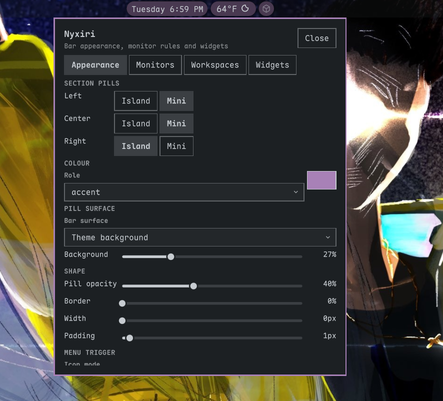
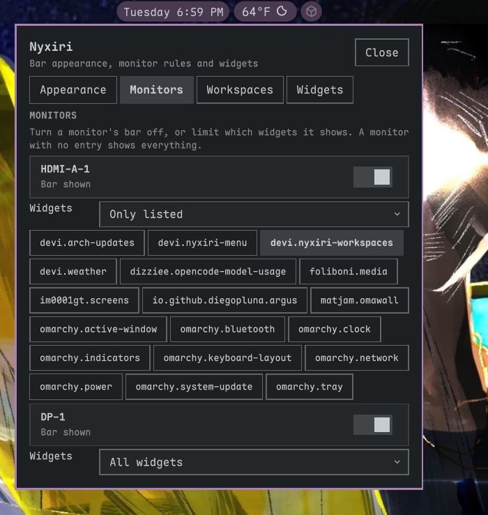
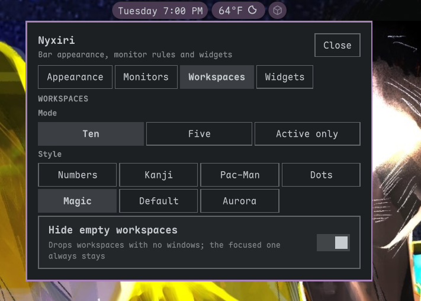
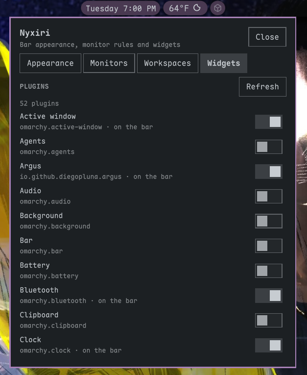
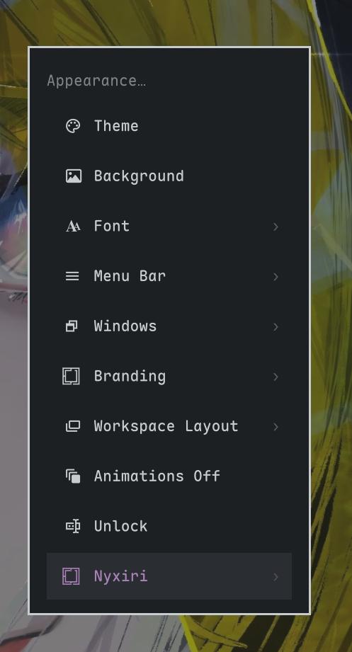
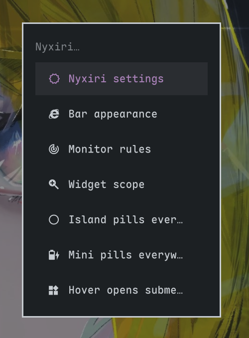
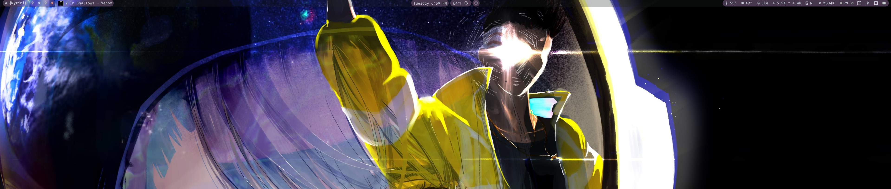

# Nyxiri

Nyxiri is a drop-in **bar plugin** for the Omarchy shell. It keeps the upstream
`omarchy.bar` engine intact and adds three things on top:

- **Section pills** — each of the left, center and right sections can be one
  island pill around the whole section, or a mini pill per widget.
- **Per-monitor rules** — switch a monitor's bar off, and choose which widgets
  it shows with `all`, `only` or `except` lists.
- **Palette colours** — pick any role from the active theme's `colors.toml`
  (not just the accent), or a custom hex, with separate fill and border
  opacity.

Settings live in an in-bar card, opened by right-clicking the bar or with:

```sh
omarchy-shell devi.nyxiri openSettings
```

Nyxiri is a plugin. It does not fork the shell and touches nothing under
`/usr/share/omarchy`.

## Preview

<table>
  <tr>
    <td></td>
    <td></td>
    <td></td>
  </tr>
  <tr>
    <td></td>
    <td></td>
    <td></td>
  </tr>
</table>



## Requirements

- Omarchy with the Quickshell-based shell (`/usr/share/omarchy/shell`).
- `omarchy-shell` on `PATH` for the settings IPC.
- `omarchy plugin` for the Widgets tab (enable/disable and bar options).

## Install

One command installs the bar and its widgets:

```sh
bash <(curl -fsSL https://raw.githubusercontent.com/Deoxizn/nyxiri/main/scripts/install-all.sh)
```

Fish has no process substitution, so wrap it:

```sh
bash -c 'bash <(curl -fsSL https://raw.githubusercontent.com/Deoxizn/nyxiri/main/scripts/install-all.sh)'
```

That installs, in order:

- **devi.nyxiri** — the bar (this repo).
- **devi.nyxiri-menu** — the Omarchy menu entry, under Appearance.
- **devi.nyxiri-workspaces** — the workspaces widget (see below).
- **deoxizn.clock** — the clock widget, with a calendar panel.
- **devi.weather** — the weather widget, 10-day forecast plus a second city.
- **devi.arch-updates** — repo, AUR, mise and git plugin/theme update counts.

Add `--with-cats` to also install the cat widgets, **deoxizn.cpurr**
and **deoxizn.bongocat**. They are fun, not core, so they are opt-in.

Everything goes through `omarchy plugin add --enable --yes`, so no
prompts. Already-installed plugins are skipped, never removed or
re-added, so re-running the installer is safe. It then sets the bar
(`omarchy bar use devi.nyxiri`), puts the widgets on it (menu first,
then workspaces, so the trigger glyph sits before the workspace
numbers on the left), and restarts the shell.

**devi.wallcraft** is deliberately not included: it is a background
service whose settings work without the bar, so it stays an independent
install:

```sh
omarchy plugin add https://github.com/Deoxizn/wallcraft.git --enable
```

To install pieces by hand instead:

```sh
omarchy plugin add https://github.com/Deoxizn/nyxiri.git --enable
omarchy plugin add https://github.com/Deoxizn/nyxiri-menu.git --enable
omarchy plugin add https://github.com/Deoxizn/nyxiri-workspaces.git --enable
omarchy-shell shell rescanPlugins
omarchy bar use devi.nyxiri
omarchy bar put devi.nyxiri-workspaces
```

The workspaces widget is optional: put it where the old workspaces widget
was and remove that one from the bar.

`omarchy plugin add` is the install: it clones a real checkout (so
`omarchy plugin update` works), validates the manifest, and `--enable`
switches the plugin on. `scripts/install.sh` in this repo is just a
wrapper around the bar and menu commands (plus `omarchy bar put
devi.nyxiri-menu` in its Next steps); it removes any existing install
first, since `plugin add` refuses an already-installed id. It does not
install the workspaces widget; that is a separate `plugin add` above.
Pass `--no-menu` to it for the bar only.

Live-edit with `scripts/install.sh --link` instead, but note a
symlinked install always fails `omarchy plugin update` validation:
Omarchy's validator refuses symlinks inside a plugin folder. A plain
copy (`scripts/install.sh --copy`) has no `.git`, so it can't be
updated either.

To go back:

```sh
omarchy bar reset
omarchy plugin disable devi.nyxiri
```

## Configuration

Nyxiri stores everything under `bar.nyxiri` in `~/.config/omarchy/shell.json`.
The settings card writes this file through the bar API; hand edits are fine and
are picked up on the next shell reload.

```jsonc
{
  "bar": {
    "id": "devi.nyxiri",
    "nyxiri": {
      "version": 1,
      "sections": {
        "left": "island",   // island | mini
        "center": "island",
        "right": "mini"
      },
      "pill": {
        "color": "accent",        // any colors.toml role, "custom", or a hex
        "customColor": "#7aa2f7",
        "fillOpacity": 0.18,
        "borderOpacity": 0.35,
        "borderWidth": 1,
        "radius": 999,            // 999 = fully rounded
        "padding": 6,             // along-bar space around an island
        "inset": 2,               // across-bar space around a pill
        "miniGap": 2,             // gap between a mini pill and its neighbours
        "surface": "theme",       // theme | clear
        "surfaceOpacity": 1       // bar background opacity, off when surface is Clear
      },
      "monitors": {
        "DP-1": {
          "enabled": true,
          "widgets": {
            "mode": "except",     // all | only | except
            "list": ["omarchy.tray"]
          }
        },
        "HDMI-A-1": { "enabled": false }
      }
    }
  }
}
```

### Sections

`centerBegin` and `centerEnd` follow `center`: all three form one island, and
mini mode pills each widget in any of the three regions.

### Monitor rules

A monitor with no entry is fully enabled and shows every widget. In a rule:

- `all` ignores `list`.
- `only` shows the listed widget ids (an empty list shows nothing).
- `except` hides the listed widget ids.

Rules match either the whole layout key (`omarchy.clock#4`) or the plugin id
(`omarchy.clock`). The id form is what the settings card writes and survives
reloads; `#serial` keys are an internal layout detail.

Disabling a monitor's bar unmaps that surface and reserves no space. Other
monitors are unaffected.

### Colours

`pill.color` names a role read from
`~/.local/state/omarchy/current/theme/colors.toml` (`accent`, `foreground`,
`red`, `bright_blue`, `color4`, …). `custom` uses `pill.customColor`, which must
be a hex colour. A hex in `pill.color` works directly too.

`surface: "clear"` drops the bar's own background so only the pills read;
`"theme"` keeps the configured Omarchy bar background.

## Settings card

Right-click any bar surface, or run one of:

```sh
omarchy-shell devi.nyxiri openSettings
omarchy-shell devi.nyxiri toggleSettings
omarchy-shell devi.nyxiri closeSettings
```

The card is a `PopupCard` centered under the bar. Its tabs are:

- **Appearance** — section modes, colour role, custom hex, fill/border
  opacity, border width, island padding, bar surface and bar background
  opacity.
- **Monitors** — per-monitor bar toggle and widget rules.
- **Workspaces** — mode, marker style, hide-empty, and the Classic
  workspaces toggle with per-monitor ranges, for the Nyxiri workspaces
  widget, shown while that widget is on the bar.
- **Widgets** — enable/disable installed plugins, add one to the bar, use a bar
  option as the active bar, or reset to the built-in bar. These actions run
  the official `omarchy` CLI, so behaviour matches the menu. The list sorts
  active plugins first, then disabled, each group alphabetical, and the
  header counts both (`52 plugins · 18 active`).

A tab whose content is taller than the card shows a scrollbar on the right
edge (Widgets, and Appearance or Monitors on a short screen); drag it or
scroll with the wheel.

## Menu integration

The separate [nyxiri-menu](https://github.com/Deoxizn/nyxiri-menu) fork adds a
**Nyxiri** entry to the Omarchy menu, under **Appearance**, and calls
`openSettings` over IPC. It is optional; Nyxiri works without it.

## Workspaces widget

The separate [nyxiri-workspaces](https://github.com/Deoxizn/nyxiri-workspaces)
plugin replaces the stock workspaces widget with one the bar can style:
eight marker styles (numbers, kanji, Pac-Man/ghost, dots, magic, default,
aurora, apps), a Ten / Five / Active only mode, and hide-empty. It also
carries a Classic workspaces mode (one global set 1-10, as in Omarchy
4.0.6, with per-monitor ranges like `DP-1:1-5,HDMI-A-1:6-10`); the card's
toggle runs the plugin's `bin/mode` and the ranges field writes the
widget's `ranges` setting. Its settings live on the widget's own layout
entry in `shell.json`, not under `bar.nyxiri`, and the card's Workspaces
tab edits them while the widget is on the bar. It is optional; Nyxiri
works with the stock workspaces widget too.

## Clock widget

The separate [omarchy-clock](https://github.com/Deoxizn/omarchy-clock)
plugin replaces the stock clock with one whose hover shows today's
calendar events (timed with start times, all-day as a count, multi-day
as "ongoing") instead of the version stamp. It reads Google Calendar
through the private "Secret address in iCal format" URL in
`~/.config/deoxizn.clock/calendars.json` (chmod 600; never share the
secret URL). It is optional; Nyxiri works with the stock clock too.

## Weather widget

The separate [omarchy-weather](https://github.com/Deoxizn/omarchy-weather)
plugin is a weather pill with a detail popup. The main location is
automatic (geo.omarchy.org IP lookup, wttr.in fallback), or pinned with
`omarchy weather location --set`. The popup shows a 10-day forecast in
one horizontal row, and a second city under it (set in the card's
Appearance tab, WEATHER section, as a name like `Tucson` or `lat,lon`).
It is optional; Nyxiri works with the stock weather widget too.

## Arch updates widget

The separate [Arch-Updates](https://github.com/Deoxizn/Arch-Updates)
plugin counts repo, AUR, mise, and git plugin/theme updates, with a
hover tooltip listing packages vertically per category, old to new
versions. Left-click runs the updater, middle-click refreshes. It is
optional.

## Cat widgets

The separate [omarchy-cpurr](https://github.com/Deoxizn/omarchy-cpurr)
and [omarchy-bongocat](https://github.com/Deoxizn/omarchy-bongocat)
plugins are fun, not core. cpurr is a sleeping cat when idle and a
running cat scaling with CPU load; Bongo Cat taps along to keystrokes
and audio. Both are opt-in with the installer's `--with-cats` flag.
They are optional.

## How it works

`Bar.qml` is a copy of upstream `omarchy.bar` with marked blocks:

```
// NYXIRI-BEGIN nyxiri-config
...
// NYXIRI-END nyxiri-config
```

There are no changes outside those blocks. `BarModel.js` is untouched.
`Nyxiri.js` holds the pure config logic and is loaded by both QML and
`node --test`.

`upstream/` holds the pristine files we last merged. To rebase:

```sh
scripts/sync-upstream.sh
```

The script runs a three-way merge (`base = upstream/`, `ours = working`,
`theirs = installed`). A clean merge updates the working files; conflicts are
written to `Bar.qml.rebase` for review and the script stops. See
[`patches/README.md`](patches/README.md).

## Development

```sh
scripts/test.sh        # node tests, shellcheck, QML parse check
scripts/sync-upstream.sh
```

The tests cover normalization, prototype-safe merging, monitor matching,
palette parsing and colour resolution.

## Limitations

- The settings card is per bar surface; opening it on another monitor replaces
  the one already open (the bar only tracks one popout at a time).
- Widget enabling uses `omarchy plugin`, so it affects the whole session, not
  one monitor. Per-monitor visibility is the rule list, not plugin enablement.
- `omarchy-shell` IPC requires the bar to be loaded; if Nyxiri failed to load,
  the stock bar is active and the IPC target is unavailable.

## Licence

MIT.
